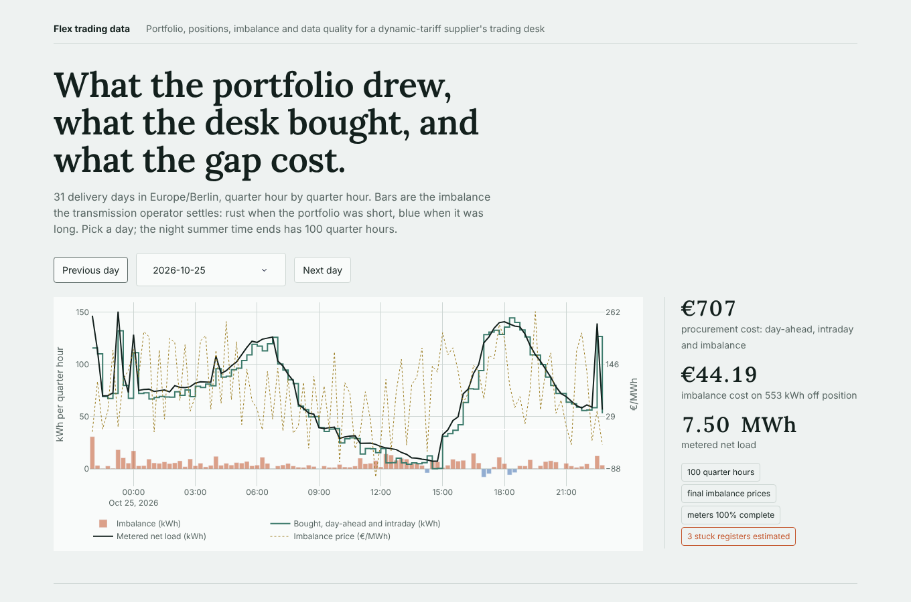

# flex-trading-datahub

The data under a dynamic-tariff power supplier's trading desk. The desk buys on the day-ahead auction, corrects
intraday, pays the imbalance price for whatever is left, and runs a virtual power plant of EVs, heat pumps, solar and
home batteries. Its data comes from every direction, and none of it arrives clean:

- **smart-meter readings** from two metering operators. One sends kWh with UTC offsets. The other sends Wh in local
  wall-clock time without an offset, so the second 02:00 on the night summer time ends can only be placed by its
  position in the day. Files arrive one to three days late, sometimes twice. Values come first as substitutes, then
  as measured, and some are corrected later. A few registers get stuck;
- **device counters** from home energy management systems (EV chargers, heat pumps, PV, batteries). They report
  every few minutes, out of order and duplicated, go offline for hours, and restart at zero after firmware updates;
- **weather forecast runs**, each with its issue time. A forecast feature is only honest if it was issued before the
  day-ahead gate;
- **EPEX day-ahead (15-minute products) and intraday prices**, and the German imbalance price (reBAP), which is
  published preliminary and revised later;
- **trades** from the trading system, as versions: amended, cancelled, sometimes exported twice.

This repository lands those feeds in an S3-style bronze layer (Parquet, once per file by content hash) and builds
them with **dbt on DuckDB** into tested models:
- `fct_portfolio_qh`: one row per quarter hour, with metered load, each device class, positions, prices, the
  imbalance and its cost, and an attribution of that cost to the desk's forecast error per class that adds up exactly;
- `fct_pnl_daily`: procurement P&L per delivery day;
- `fct_data_quality_daily`: is each day complete and settled;
- `feat_load_qh`: forecasting features using only what was known at the gate.

An **Airflow** DAG runs it hourly, and a **Python dashboard** (Dash and Plotly) shows it to the desk. Everything is
measured against a simulated portfolio (400 households, 346 devices, 31 days from
2026-10-01) and a held-out month that was run once.



## Against a first version of the same warehouse

Same bronze files. The first version is plain SQL that handles units and offsets but:
- keeps every version of a meter value and every version of a trade;
- reads local times without an offset as ordinary local times;
- settles on the first imbalance price published;
- differences device counters as they come.

| | first version | **this warehouse** | held-out month (this vs first) |
|---|---|---|---|
| Portfolio energy off from the truth | 5.39 MWh (2.67%) | 0.64 MWh (0.32%) | – |
| Quarter hours within 0.5% of the true net load | 7.5% | 78.5% | – |
| Imbalance cost for the month (truth) | -€2,039 (-€65) | -€97 (-€65) | – |
| Imbalance cost, sum of daily errors | €2,014 | €46 | – |
| Days with procurement cost within 1% | 16% | 100% | – |
| Imbalance cost attribution off from the truth | €6,375 | €141 | – |

Dev month: 1,547,040 meter values, 666,760 device reports,
6,407 trade versions and 157 forecast runs. The portfolio is a few hundred
households, so the euro amounts are small. The ratios are the point.

**Where the month's imbalance cost came from**, against the truth:

| class | truth | this warehouse | first version |
|---|---|---|---|
| base | -€8 | -€78 | €3,047 |
| heat pump | €45 | €36 | -€465 |
| ev | -€114 | -€65 | -€2,232 |
| pv | €15 | €8 | €367 |
| battery | -€96 | -€91 | -€437 |

## Faults that were planted, and what was found

| fault | planted | handled |
|---|---|---|
| stuck registers | 3 | 3 found, 0 false alarms; values estimated from the meter's own profile for analysis |
| meter-days first sent as substitutes | 325 | 0 substitute values left once the measured ones arrived |
| files delivered twice | 12 | all skipped at landing by content hash |
| device counters restarted at zero | 18 | 18 stitched on |
| the night summer time ends | 2026-10-25 | 100 quarter hours, as expected |

A second landing and dbt run changes nothing: yes.

## Forecasting on features known at the gate

The same LightGBM model was trained on two feature sets: `feat_load_qh`, and the first version's features (the newest
weather run for each hour, and yesterday's metered load). It was then tested on the last 7 days.

| features | backtest error | error in production | exposure at the imbalance price |
|---|---|---|---|
| known at the gate (`feat_load_qh`) | 12.86 kWh | 12.86 kWh | €877 |
| leaking the future | 11.97 kWh | 12.99 kWh | €898 |
| the desk's own day-ahead position | – | 8.25 kWh | €564 |

- The leaking feature set looks 1.02 kWh per quarter hour better in its backtest than it
  does in production. The honest one backtests at exactly what production gets.
- Neither model beats the desk's own class-by-class forecast. The model is here to show the features are safe to
  build on, not to replace the desk.

## Gate

The gate was written after the first dev results and before the held-out month was run (`config/gate.yaml`).

| line | dev | held-out H1 |
|---|---|---|
| dbt builds and every dbt test passes | yes ✅ | – |
| every delivery day has its quarter hours (92 / 96 / 100) | 100.0% ✅ | – |
| portfolio energy off by under 1% in total | 0.3% ✅ | – |
| quarter hours within 0.5% of the true net load | 78.5% ✅ | – |
| days with procurement cost within 1% | 100.0% ✅ | – |
| imbalance cost error, as a share of the first version's | 2.3% ✅ | – |
| attribution error, as a share of the first version's | 2.2% ✅ | – |
| every stuck register found | 3 ✅ | – |
| no working meter called stuck | 0 ✅ | – |
| no substitute value left once a measured one arrived | 0 ✅ | – |
| every resent file skipped | 100.0% ✅ | – |
| a second run changes nothing | yes ✅ | – |
| the forecast backtest is what production gets | 0.0 kWh ✅ | – |

Dev passes 13 of 13 lines. The held-out month has not been run yet.

## Run it

```bash
pip install -r requirements.txt
python -m pytest -q                          # a four-day world (with the 100-quarter-hour day) built and tested, about 15 s
python -m ftd.eval.cli evaluate              # the dev month: world, landing, dbt build, comparison, forecast, gate, about 2 min
cd dbt && FTD_DUCKDB=../warehouse/flex.duckdb dbt build --vars "{lake: '../work/D1/lake'}"   # dbt directly on a kept lake
python -m dashboard.app                      # the dashboard on :8050 (FTD_DUCKDB=<warehouse> for live marts)
```

Where things live:
- `ftd/world`: the simulated portfolio and its truth (nothing else imports it);
- `ftd/ingest.py`: raw to bronze;
- `dbt/`: staging, intermediate, marts and their tests;
- `dags/`: the Airflow DAG;
- `dashboard/`: the Dash app, feature-first, with theme tokens;
- `ftd/eval`: the comparison, scoring, gate and this README.

On AWS, bronze is an S3 prefix and the same models run with dbt-athena or on DuckDB reading S3. [docs/aws.md](docs/aws.md)
covers that, and [docs/agentic-workflow.md](docs/agentic-workflow.md) covers how a coding agent was used to build this.
